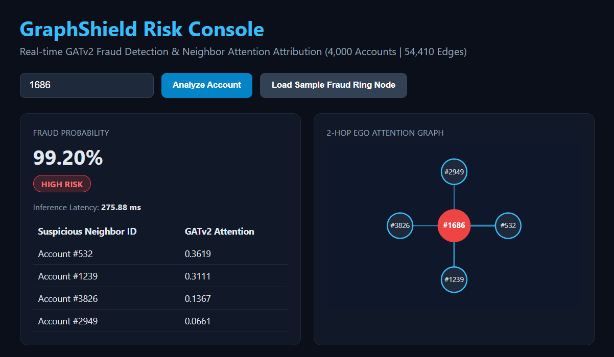

# GraphShield: Graph Neural Network Fraud Detection & Attribution Engine

End-to-end financial fraud detection system built with **PyTorch Geometric** and **FastAPI**. Models multi-hop money flows, cyclic layering rings, and temporal velocity bursts using **GATv2 (Graph Attention Networks)** with edge attributes.

## Architecture & Pipeline

* **Data & Topology Generation (`src/data_generator.py`):** Simulates a scale-free financial transaction network (4,000 accounts, 28,809 transactions) with embedded cyclic laundering rings and legitimate high-velocity burst users.
* **Graph Construction (`src/graph_builder.py`):** Engineers 22 node behavioral/velocity features with leakage-free `StandardScaler` (fit strictly on `train_mask`) and builds 54,410 bidirectional edges carrying `(tx_count, total_volume, mean_volume)` attributes.
* **GNN Modeling (`src/models.py`):** 2-layer **GATv2** with multi-head edge attention, `BatchNorm1d`, and residual skip connections (`x_skip`) to prevent over-smoothing, trained with class-weighted BCE loss and early stopping on validation PR-AUC.
* **Real-Time Scoring API (`src/api.py`):** FastAPI `/score` endpoint returning fraud probability, risk tier (`LOW` / `MEDIUM` / `HIGH`), inference latency, and top-3 suspicious neighbor accounts via learned GATv2 attention weights.

## Benchmark Results (Test Split)

Evaluated on a stratified 70/15/15 split (~4.88% positive fraud rate):

| Model | Paradigm | PR-AUC | ROC-AUC | F1-Score | Precision | Recall |
| :--- | :--- | :---: | :---: | :---: | :---: | :---: |
| Logistic Regression | Tabular Baseline | 0.8103 | 0.9888 | 0.7429 | 0.6341 | 0.8966 |
| XGBoost | Gradient Boosted Trees | 0.9853 | 0.9992 | 0.9310 | 0.9310 | 0.9310 |
| GCN | Spectral GNN | 0.8681 | 0.9883 | 0.7458 | 0.7333 | 0.7586 |
| GraphSAGE | Inductive Spatial GNN | 0.9720 | 0.9977 | **0.9455** | **1.0000** | 0.8966 |
| **GATv2 (Ours)** | **Edge-Aware Attention GNN** | **0.9904** | **0.9995** | 0.9032 | 0.8485 | **0.9655** |

## Key Engineering Takeaways

* **Why GNNs Outperform Tabular Baselines:** Legitimate high-velocity burst users mimic fraud ring velocity on single-node features (`0.8103` PR-AUC on Logistic Regression), whereas 2-hop graph attention isolates closed cyclic money-laundering rings (`0.9904` PR-AUC).
* **High-Recall Fraud Prioritization:** `GATv2` achieves the highest **PR-AUC (`0.9904`)** and **Recall (`96.55%`)** by weighting incoming/outgoing edges with transaction volume and frequency attributes, while `GraphSAGE` maximizes precision (`1.0000`).

## Project Structure

* `configs/config.yaml` — Hyperparameters, data split ratios, and artifact paths
* `src/data_generator.py` — Synthetic transaction network and collusion ring generator
* `src/graph_builder.py` — Behavioral feature engineering and PyTorch Geometric `Data` builder
* `src/models.py` — `GCNFraudDetector`, `GraphSAGEFraudDetector`, and `GATv2FraudDetector`
* `src/train.py` — Class-weighted training loop with validation PR-AUC checkpointing
* `src/evaluate.py` — End-to-end benchmark comparing tabular and GNN models
* `src/api.py` — FastAPI inference service with neighbor attention attribution
* `tests/test_pipeline.py` — Unit tests verifying split disjointness and model forward pass

## Quickstart

1. **Install dependencies:** `pip install -r requirements.txt`
2. **Generate dataset & build graph:** `python -m src.data_generator && python -m src.graph_builder`
3. **Train & benchmark all models:** `python -m src.evaluate`
4. **Run unit tests:** `python -m pytest -v`
5. **Start FastAPI server:** `uvicorn src.api:app --reload`